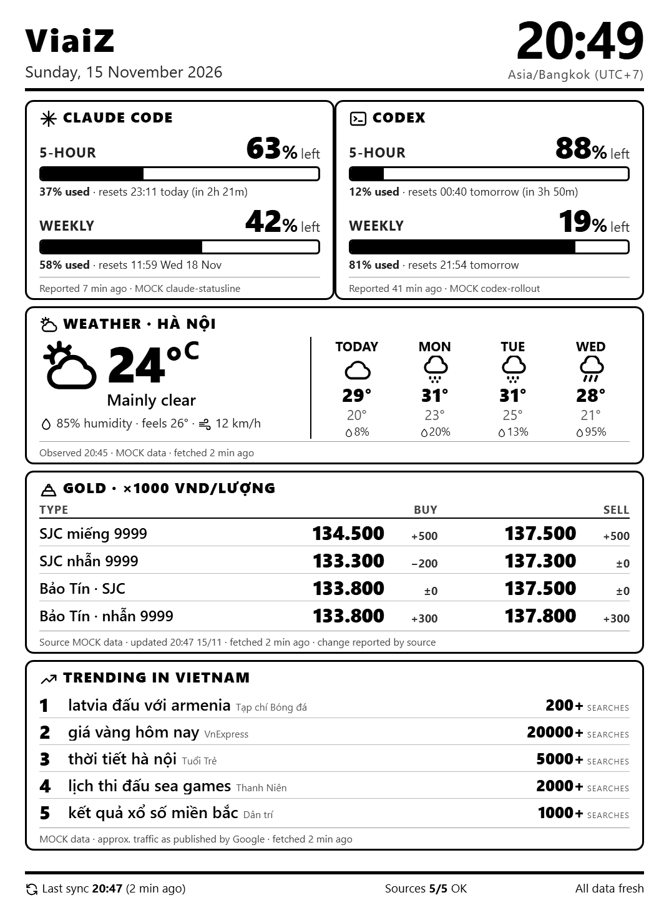
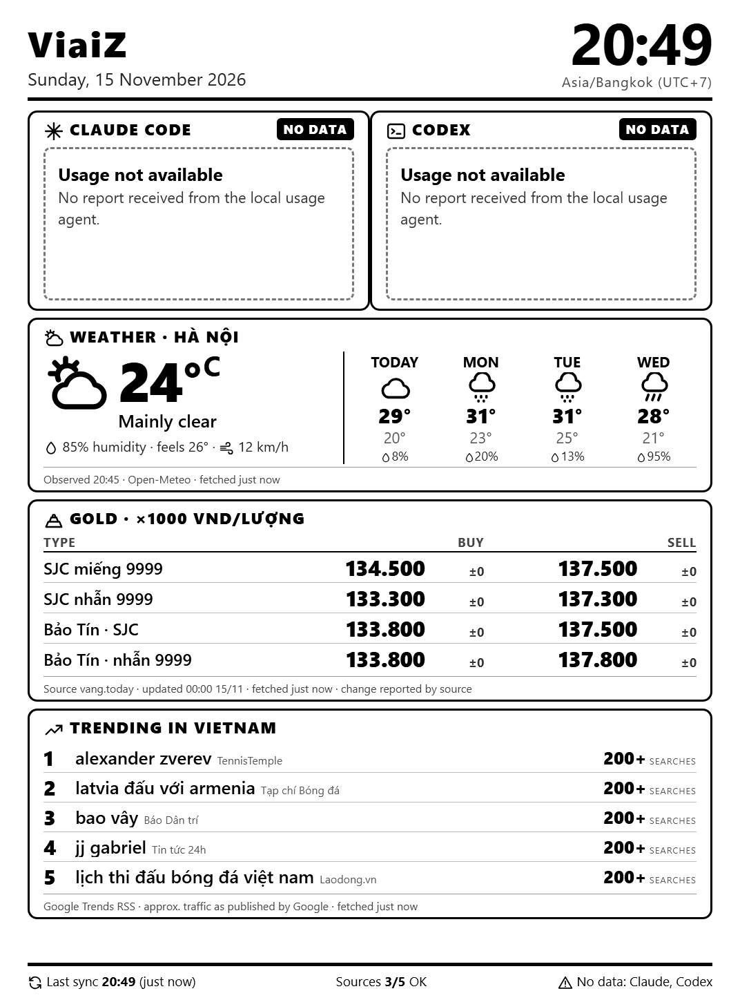
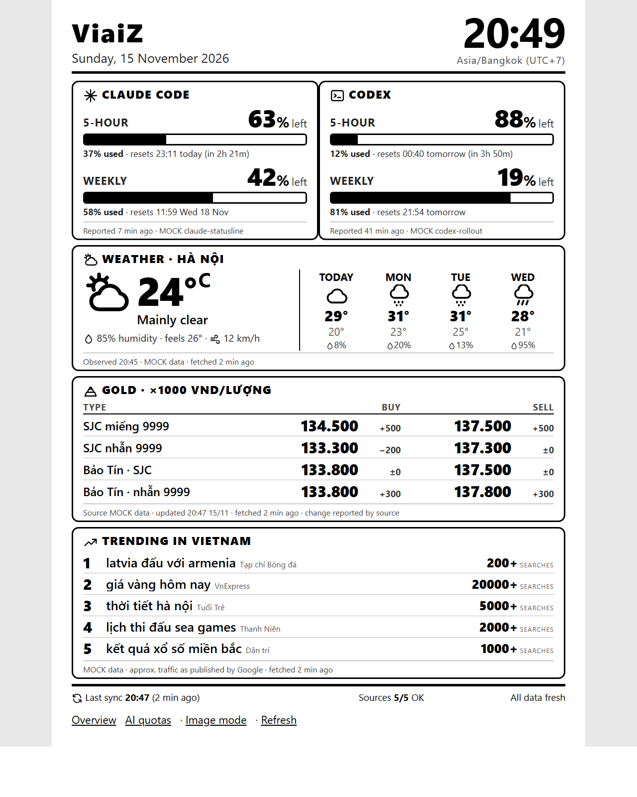

# ViaiZ E-Ink Dashboard

A self-hosted, always-on dashboard for an old **Kindle Paperwhite 3** (7th gen, 1072×1448, 6″, 16-level grayscale).

It shows:

- **Claude Code** and **OpenAI Codex** plan usage: 5-hour and weekly windows, remaining vs. consumed share, and reset time.
- **Hà Nội weather**: current conditions plus a 4-day forecast (Open-Meteo).
- **Vietnam gold prices**: SJC and Bảo Tín, buy/sell and change (configurable API).
- **Google Trends Vietnam**: top 5 searches, with Google's own approximate traffic.
- Date, time, last sync, source health and stale-data indicators.



| Live data (no usage agent yet) | Responsive desktop preview |
|---|---|
|  |  |

`mock-main.png` uses the example data in `mock/dashboard.json`, and every section is labelled **MOCK**. `live-main-no-agent.png` was rendered from real Open-Meteo, vang.today and Google Trends responses. The usage cards say **NO DATA** because no usage agent was reporting.

---

## Architecture

```
            ┌───────────── VPS (Docker Compose) ─────────────────────────────┐
 Open-Meteo ─┤ weather collector ┐                                           │
 vang.today ─┤ gold collector    ├─► cache (Redis or JSON file) ─► Builder ──┤─► GET /api/dashboard (JSON)
 Google RSS ─┤ trends collector  ┘        ▲  last good value kept           │─► GET /dashboard (HTML, old-WebKit safe)
             │                            │  staleness computed on read     │─► GET /dashboard/preview (responsive)
 workstation │  POST /api/ingest/usage ───┘                                  │─► GET /dashboard/image (stock Kindle)
 usage-agent ┤  (Claude statusLine, Codex rollout files)                     │
             │                        Chromium (CDP) screenshots /dashboard │─► GET /api/eink/frame.png (8-bit gray, 16 levels)
             └───────────────────────────────────────────────────────────────┘
                                                     │
                     Kindle PW3 ◄────────────────────┘  stock browser (Mode A) or FBInk loop (Mode B)
```

| Layer | Choice | Notes |
|---|---|---|
| Backend | Go 1.24, `net/http`, `log/slog` (JSON logs) | single static binary |
| Frontend | server-side `html/template` + plain CSS | Not React: the stock Kindle browser is an old WebKit. The page uses no JS, flexbox, grid or CSS variables. |
| Cache | in-memory + JSON file, or Redis | Redis is optional (`REDIS_URL`) |
| Rendering | headless Chromium driven over the DevTools protocol ([chromedp](https://github.com/chromedp/chromedp)) | Same engine Playwright drives, without a Node runtime. The output is quantized to 16 gray levels, encoded as an 8-bit grayscale PNG, and cached for 60 s. |
| Deploy | Docker Compose on Ubuntu | Chromium and fonts (Inter, Noto, with Vietnamese glyphs) are in the image |
| Kindle | KUAL extension (`sh` + FBInk) | Mode B: jailbroken Kindles |

### Repository layout

```
cmd/server/            HTTP server, collectors, renderer
cmd/usage-agent/       workstation agent (Claude statusLine + Codex rollout → ingest)
internal/collector/    weather, gold, trends + scheduler (timeouts, retries, backoff, fallback)
internal/dashboard/    normalized dashboard assembly, staleness, usage ingest validation
internal/render/       Chromium screenshot → grayscale PNG
internal/web/          handlers, auth, templates, CSS, icons
internal/agent/        usage parsers (tested)
config/config.yaml     collectors, pages, render settings
mock/dashboard.json    example data for UI work
kindle/                KUAL extension + install/uninstall scripts
docs/                  KINDLE.md, JAILBREAK.md, USAGE-AGENT.md, screenshots
```

---

## Quick start (local)

```bash
go build -o bin/ ./cmd/...
```

```bash
AUTH_DISABLED=true MOCK_DATA=mock/dashboard.json CHROME_PATH="/path/to/chrome" ./bin/server
```

Then open:

- http://localhost:8080/dashboard/preview: responsive preview
- http://localhost:8080/dashboard: fixed 1072×1448 layout (what the Kindle sees)
- http://localhost:8080/api/eink/frame.png: the rendered PNG
- http://localhost:8080/api/dashboard: the normalized JSON

For real data, drop `MOCK_DATA`. Without `AUTH_DISABLED`, you must set `DEVICE_TOKENS`.

Run the tests:

```bash
go test ./...
```

```bash
CHROME_PATH=/path/to/chrome go test ./internal/render/   # includes a real Chromium render test
```

---

## Ubuntu VPS deployment

Tested target: Ubuntu 22.04 or 24.04 with 1 vCPU and 1 GB RAM. Chromium uses about 150–250 MB while it renders.

1. **Install Docker**:

   ```bash
   curl -fsSL https://get.docker.com | sudo sh
   ```

   ```bash
   sudo usermod -aG docker $USER
   ```

   Log out and back in after `usermod`.

2. **Get the code and configure it**:

   ```bash
   git clone <your-repo-url> viaiz && cd viaiz
   ```

   ```bash
   cp .env.example .env
   ```

   ```bash
   openssl rand -hex 24
   ```

   Run `openssl rand -hex 24` twice. Put one value in `DEVICE_TOKENS` and the other in `INGEST_TOKENS`.

   ```bash
   nano .env
   ```

   ```bash
   mkdir -p data && sudo chown 10001 data
   ```

   The container runs as uid 10001, so it must own `data/`.

   Edit `config/config.yaml` if you want different gold items, pages or intervals.

3. **Start it**:

   ```bash
   docker compose up -d --build
   ```

   ```bash
   curl -s localhost:8080/api/eink/health
   ```

   To run without Redis, delete the `redis` service and the `depends_on` / `REDIS_URL` lines in `docker-compose.yml`. The JSON file cache in `./data` survives restarts.

4. **Add TLS with a reverse proxy.** The Kindle sends a token, so use HTTPS. Example with Caddy:

   ```bash
   sudo apt install -y caddy
   ```

   Contents of `/etc/caddy/Caddyfile`:

   ```
   dash.example.com {
       reverse_proxy 127.0.0.1:8080
   }
   ```

   ```bash
   sudo systemctl reload caddy
   ```

   Caveat: the stock PW3 browser may not support modern TLS settings. If HTTPS pages fail to load there, use Mode B (FBInk with curl), or expose plain HTTP on a private network or VPN only. See [docs/KINDLE.md](docs/KINDLE.md).

5. **Update**:

   ```bash
   git pull && docker compose up -d --build
   ```

6. **Logs**:

   ```bash
   docker compose logs -f dashboard
   ```

   Logs are JSON. Query strings are never logged, because they can carry device tokens.

---

## Endpoints

| Method / path | Auth | Purpose |
|---|---|---|
| `GET /api/dashboard` | device | Normalized JSON, including per-section `meta.status`: `ok`, `stale`, `error`, `unavailable` or `disabled` |
| `GET /api/eink/frame.png?page=main[&force=1]` | device | 1072×1448 8-bit grayscale PNG (16 levels). Headers: `X-Rendered-At`, `Last-Modified` |
| `GET /api/eink/health` (and `/healthz`) | public | Status of cache, renderer and each source. No data and no error text |
| `GET /dashboard?page=main[&refresh=900]` | device | Fixed e-ink layout. Old-WebKit safe, no JS, optional `<meta refresh>` |
| `GET /dashboard/preview?page=main` | device | Responsive preview for desktop or phone |
| `GET /dashboard/image?page=main` | device | Stock-Kindle image page: PNG plus a "tap to refresh" link |
| `POST /api/ingest/usage` | ingest | Usage snapshot from the workstation agent |

**Auth.** Device tokens are accepted as `Authorization: Bearer <t>`, `X-Device-Token: <t>` or `?token=<t>`. The query form exists because the stock Kindle browser cannot set headers, and links on the page carry it forward. Ingest tokens are a separate set and are accepted only in the `Authorization` header. Tokens are compared in constant time, and the server refuses to start with no device tokens unless `AUTH_DISABLED=true`.

**Pages.** Each entry under `pages:` in `config.yaml` is a separate frame (`?page=<name>`) with its own widget list, for example a second `ai` page. Header and footer always appear.

---

## Data sources and honesty rules

| Widget | Source | Interval | Stale after | Notes |
|---|---|---|---|---|
| Weather | Open-Meteo `/v1/forecast`, Hà Nội 21.0285, 105.8542, `timezone=Asia/Bangkok` | 30 min | 2 h | Current conditions and 4 days, WMO codes mapped to text and icons |
| Gold | `vang.today/api/prices` (default) or a generic JSON API | 15 min | 6 h | Prices are VND/lượng, shown ×1000. The change shown is the one the source reports. On the generic provider, change is measured against the previous fetch, and the basis is printed |
| Trends | `trends.google.com/trending/rss?geo=VN` | 30 min | 4 h | Traffic is Google's own bucket (for example `2000+`), shown verbatim. No volumes are derived |
| Claude Code | workstation `usage-agent` → `statusLine` `rate_limits` | on use | 6 h | See [docs/USAGE-AGENT.md](docs/USAGE-AGENT.md) |
| Codex | workstation `usage-agent` → Codex rollout `rate_limits` | on use | 6 h | Undocumented local format, parsed leniently |

Rules the code enforces, all covered by tests:

- **Nothing is fabricated.** Missing values render as "—", "n/a", "NO DATA" or "Usage not available". They are never 0.
- **Failures keep the last good value** and mark the section `STALE` or `RETRYING`. The footer lists stale and missing sources.
- **Past reset times hide old numbers.** If a quota window's `resets_at` has passed, the old percentage no longer applies. The widget shows "?" and "reset at … · awaiting new report" instead of a guessed 100%.
- **Plan usage is not API billing.** The usage widgets show subscription rate-limit windows only.
- Mock data is labelled `MOCK` on screen and is never written to persistent storage.

**Gold source caveats.** `sjc.com.vn` sits behind a Cloudflare challenge, and the public BTMC API returned an empty response when tested on 2026-11-15. The default provider is therefore vang.today, whose SJC and Bảo Tín codes were verified. The `BTSJC` and `BT9999NTT` codes are labelled "Bảo Tín" because the provider does not say whether they are Bảo Tín Minh Châu (BTMC) or Bảo Tín Mạnh Hải. Rename them in `config.yaml` once you have confirmed which it is.

---

## Reliability

- One goroutine per collector, with a per-attempt timeout and retries using exponential backoff and ±20% jitter (2 s, 4 s, 8 s…, capped at 2 min). Permanent errors (HTTP 4xx, parse errors) are not retried.
- The cache keeps the last good payload, last attempt and last error, and staleness is computed on every read.
- The renderer starts Chromium lazily, restarts it after a crash, and collapses concurrent requests into one render. If a render fails, it serves the previous frame.
- `/api/eink/health` drives the Docker `HEALTHCHECK`.

## Kindle

- **Mode A (stock browser):** open `/dashboard/image?token=…` and tap to refresh. The stock browser cannot refresh in the background.
- **Mode B (jailbroken, FBInk):** a KUAL extension downloads the PNG every 15 minutes and draws it with FBInk.

Full guide: [docs/KINDLE.md](docs/KINDLE.md).

## Verified vs. not verified

| Item | Status |
|---|---|
| Collectors against live Open-Meteo, vang.today and Google Trends RSS (2026-11-15) | ✅ verified |
| Chromium render to a 1072×1448 8-bit gray PNG (Chrome 157 on Windows) | ✅ verified |
| Usage ingest end-to-end (agent `statusline` → `push` → dashboard), using a synthetic statusLine payload | ✅ verified |
| Claude statusLine `rate_limits` field names | per the docs (code.claude.com/docs/en/statusline); not observed with a live subscription |
| Codex rollout `rate_limits` format | ⚠️ not verified: no rollout files on the dev machine; the parser is lenient |
| Kindle client loop logic (refresh cadence, failure overlay, cleanup) | ✅ verified in a simulation with stubbed `fbink` and `lipc` |
| FBInk flags, Wi-Fi `lipc` calls, suspend mode on a real PW3 | ⚠️ not verified on hardware |
| Stock Kindle browser rendering and TLS compatibility | ⚠️ not verified on hardware |
| Docker image build | see the note in the final report |
